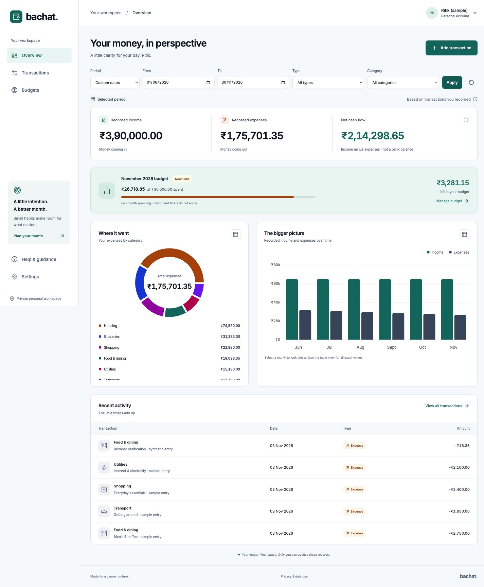

# Bachat

**Your money, in perspective.**

A responsive personal finance website for recording INR income and expenses, understanding spending, and setting a realistic monthly limit. Built from the six product/technical documents in [docs](docs/01-product-requirements.md).



## What works

- Email/password registration, explicit verification, sign-in, password recovery, password change and current/all-session logout.
- Private transaction creation, history, detail, edit and confirmed deletion; exact paise arithmetic and date-only business rules.
- Date/type/category filters, 25-row pagination, exact totals over all matching entries, category donut and monthly bars with equivalent data tables.
- One overall monthly expense budget, near/reached/over states, full-month scope independent of dashboard filters.
- Responsive dashboard, mobile navigation/filter sheet, accessible dialogs, unsaved-change guard, errors/empty/loading/offline states and same-tab transaction draft recovery.
- Profile settings, atomic account deletion and separate deletion-control records for safe recovery.
- A real MongoDB replica-set development database with persistent local files, local transactional-email capture, synthetic seeding, migrations, maintenance and restore-scrub tools.
- GitHub CI, 26-operation [OpenAPI contract](docs/api.openapi.json), [deployment runbook](docs/09-deployment-and-recovery.md) and [monetization strategy](docs/08-monetization-strategy.md).

Net cash flow is **recorded income minus recorded expenses**, not a bank balance. No bank connection, money movement or live billing is implemented. Product analytics and session replay are disabled.

## Run locally

Use Node 24 (see `.nvmrc`), npm and an internet connection for the first MongoDB binary download from the official MongoDB distribution. The installed Node 24.17.0 runtime was used for local verification.

```sh
npm ci
npm run dev
```

Open [Bachat locally](http://localhost:5173). The API runs on 127.0.0.1:4000 and local Mongo on 127.0.0.1:27018. Use **localhost** for the browser so its Origin matches the default. The development launcher stores private files under ignored `.data/` and binds only to loopback. Do not expose this development server publicly.

With no MONGODB_URI, the launcher starts a real single-node MongoDB replica set using `mongodb-memory-server` and persistent `.data/db` files. Despite the package name, the configured database files persist across clean restarts. This is local integration infrastructure, not Atlas evidence or managed backups. Avoid deleting `.data/` if you want to keep your local records.

To use your own database, copy `.env.example` to `.env` and configure a transaction-capable MongoDB URI. Actual environment files are ignored. Never paste keys/URIs in chat or commit them. Independent local session/CSRF secrets are generated once under `.data/dev-secrets.json`.

### Explore synthetic data

While the dev API is running:

```sh
npm run seed:demo
```

This creates a new **local-only** verified synthetic account with six months of sample entries. Its random credentials are saved with restricted permissions in `.data/demo-account.json`; they are never printed or committed. Sign in with those values. The script rejects production mode. Do not run it against a customer database.

Normal signup remains available. Without a configured email provider in development, verification/reset messages are captured as private JSON files in `.data/mail/`. Open the relevant captured link locally. With RESEND_API_KEY and a verified MAIL_FROM configured, the mail adapter sends actual transactional email instead. Neither captured mail nor provider API acceptance proves inbox delivery.

### Validation and build

```sh
npm run typecheck
npm test
npm run build
```

The test suite starts its own isolated MongoDB replica set. It covers exact money/date rules, account isolation, token/session lifecycle, duplicate and concurrent saves, versions, budgets, pagination, a real 10,000-row history, deletion races and injected purge failure. A 20-request local aggregation burst is evidence about that fixture only; it is not the five-minute load/availability target from the planning documents.

The build outputs React assets to `dist/client` and compiled API/scripts to `dist/server`. `npm start` runs the compiled API. In production, Express also serves the client and deep-link fallback. Production startup requires a database, independent secrets, verified email settings, HTTPS origin (or Render's public URL), and privacy contact; it deliberately refuses incomplete configuration.

## Architecture

React + TypeScript + Vite + Tailwind, TanStack Query, Recharts, Express, Mongoose/MongoDB, Argon2id, signed JWT cookie backed by revocable server sessions, signed double-submit CSRF, and a Resend mail adapter. Self-hosted Inter avoids third-party font requests from private screens.

Client forms use shared Zod rules/native field constraints and explicit local state rather than the form-library option in planning. Core business validation always runs on the server.

Amounts are BSON Int64 paise. User IDs are derived from sessions. Financial writes lock the owner, check resource versions and persist successful operation receipts atomically. Dashboard sections are read from one snapshot. Account deletion also creates an authoritative recovery tombstone in the separate control DB.

## Deployment and commercial readiness

Render workspace selected by the owner: `tea-d8pqhvb6sc1c73d1dhmg`. [render.yaml](render.yaml) is a hosting definition, not evidence that a service is live. Follow the [deployment/recovery runbook](docs/09-deployment-and-recovery.md).

The dedicated Atlas project **Bachat** and free **bachat** cluster now exist in AWS Singapore. The current development IP is allowlisted. Database-user creation, the private connection URI and live migrations remain pending; see [Atlas setup status](docs/11-atlas-setup.md). The earlier organization AI-access restriction has been resolved.

Cloud launch still requires a verified sender/key, an actual privacy contact, scheduled maintenance/monitoring, backup/restore validation and live smoke checks. No paid infrastructure or real payment integration has been activated.

Monetization is specified as a proposed future paid tier with a validation sequence. It is not a revenue claim. Existing user privacy/security/deletion and correction of stored records must remain independent of subscription state.

## Source and ownership

Repository: [Ritik0712-ai/Bachat](https://github.com/Ritik0712-ai/Bachat). Commits use Ritik Agarwal's personal identity. Original planning documents are preserved; implementation choices and limitations are tracked separately in [build decisions](docs/07-build-decisions.md) and the verification report.
