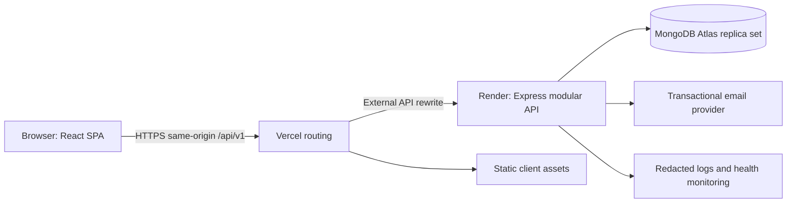

# Personal Finance Tracker - Technical Requirements Document

Version: 1.0 | Prepared: 3 November 2026 | Status: proposed architecture

Dependencies: [PRD](01-product-requirements.md), [flows](03-app-flows.md), [schema](05-backend-schema.md), [delivery plan](06-implementation-plan.md). Financial rules in PRD section 8 and storage definitions in the schema are normative.

## 1. Architecture and assumptions

Build a modular monolith: one React client, one Express API and one MongoDB database. Initial capacity assumptions are 1,000 registered accounts, 100 daily active users, 20 simultaneous active sessions and at most 10,000 transactions per user. These are sizing inputs, not measured demand. No service mesh, queue, Redis, GraphQL, WebSockets or event-sourced ledger is necessary for V1.



Browser API requests always target relative `/api/v1`. Vercel proxies that path to the Express origin before the SPA fallback. This keeps cookies first-party. The Render origin remains network-accessible, but the browser never calls it directly. Authenticate every request regardless of route origin; validate Origin/CSRF for unsafe methods. Do not trust a proxy header alone as user authentication.

## 2. Selected stack and decision record

| Area | Selection | Reason and trade-off |
|---|---|---|
| Language | TypeScript, strict mode, client/server/shared | Consistent DTOs; runtime validation still mandatory |
| Client build | React + Vite | Matches source; no SSR/SEO need inside private dashboard |
| Styling | Tailwind CSS, light theme | Fast consistent responsive layout; use tokens rather than arbitrary styles |
| Routing | React Router | Explicit public/protected routes and stable deep links |
| Server state | TanStack Query | Cache invalidation, loading and retry; auth Context contains safe session summary only |
| Forms | React Hook Form + Zod | Shared field validation; backend remains authoritative |
| Charts | Recharts | Source-supported React charts; add independent HTML data tables |
| HTTP | Native Fetch wrapper | Fewer dependencies; standardized errors, timeout and credentials |
| Server | Node.js 24 LTS major + Express | Source-compatible; conservative supported major, not a claim that it is newest |
| Persistence | MongoDB Atlas + Mongoose | Preserve source; explicit ownership, indexes and schema validation |
| Auth | First-party JWT cookie plus server session lookup | Meets JWT brief, supports immediate logout/revocation; extra DB read is acceptable |
| Passwords | Argon2id | Tunable memory-hard hashing; benchmark cost on deployment runtime |
| Transactional email | Resend behind a `Mailer` interface | Verification/reset only; provider swap must not change domain services |
| Hosting | Vercel client, Render API, Atlas DB | Matches source; introduces proxy/cookie and separate release checks |
| Tests | Vitest, React Testing Library, Supertest, Playwright | Domain, API, component and real browser coverage |

Choose compatible maintained stable library releases during setup, pin exact resolved versions in the lockfile, and record runtime/database versions in README and CI. Node major is fixed to 24 for this proposal; resolve and pin its supported security patch during setup. Do not copy unverified package-version strings from prose.

Check runtime support against the [official Node.js release table](https://nodejs.org/en/about/previous-releases). The email adapter follows the [Resend Node SDK guide](https://resend.com/docs/send-with-nodejs); a verified sender domain and API key are deployment prerequisites, not provisioned assets.

Use `Intl.NumberFormat('en-IN', {style:'currency', currency:'INR'})` for display. Never use formatted values for calculations. Date-only strings must not be parsed through UTC midnight and shifted into another date by browser timezone.

## 3. Repository and module structure

```text
client/src/
  app/              router, providers, shell, error boundary
  features/         auth, dashboard, transactions, budgets, settings
  components/       form controls, dialogs, tables, charts
  lib/              fetch client, money/date formatters, query keys
server/src/
  app.ts            middleware and route composition
  server.ts         process startup and graceful shutdown
  modules/          auth, users, categories, transactions, analytics, budgets
  middleware/       authentication, csrf, validation, errors, rate limits
  infrastructure/   database, mailer, structured logging
  scripts/          indexes, migrations, fixture generation
shared/             DTO schemas, enums, pure money/date contracts
tests/              fixtures, API integration and browser journeys
docs/               this six-document pack, later OpenAPI and runbooks
```

Controllers map HTTP only; services own invariants, authorization and transaction boundaries; repositories own Mongoose queries. No client imports of server secrets or models. No route handler accepting arbitrary Mongo filters or update documents.

## 4. Authentication and session protocol

### 4.1 Account lifecycle

Registration validates name (1-80 trimmed characters), normalized email (trim/lowercase, <=254 characters) and password (12-128 characters; allow spaces/paste, no forced composition rules). Do not transform the password. Hash using Argon2id with initial parameters memory 19 MiB, iterations 2, parallelism 1; benchmark and increase when feasible. Never log it.

Create an unverified user, 14 seeded categories and a verification token atomically. Send a verification link after commit. Existing-email and new-email signup both return generic 202; existing unverified accounts may receive a new verification email under cooldown without changing their stored password. Existing verified accounts are not modified. A failed email send does not roll back the user; log a redacted operational failure and allow resend.

Verification token: 32 cryptographically random bytes, store SHA-256 hash only; expiry 24 hours; one use. Reset token: same construction, 30-minute expiry. Issuing a new token invalidates older unconsumed tokens of that kind. URLs use fragment `#token=...`, which the client reads into memory and immediately removes with `history.replaceState`; the client POSTs the token. Set `Referrer-Policy: no-referrer` on auth pages. No login is created merely by opening or consuming the verification link; show success then sign in.

Login returns generic 401 for invalid email/password; use dummy hash verification for absent emails. Correct credentials on an unverified account return 403 `EMAIL_UNVERIFIED` without creating a session. Password recovery always returns generic 202 irrespective of address/delivery success. Password reset consumes token and increments `authVersion`, revokes every session, then requires fresh login. No email-address changes in V1.

### 4.2 JWT plus revocable server session

Successful login creates a `sessions` row and signs JWT claims `sub=userId`, `sid=sessionId`, `av=authVersion`, `iat`, `exp`, fixed `iss` and `aud`. Sign using an allowlisted HS256 algorithm with >=256-bit random server secret and key identifier for controlled rotation. Do not accept algorithm negotiation from the request. JWT contains no email, name or financial data.

Cookie: `__Host-pft_session`, HttpOnly, Secure, SameSite=Lax, Path=/, no Domain, Max-Age 604800. Absolute lifetime seven days; idle lifetime 24 hours, checked against server session `lastSeenAt`. There is no refresh-token flow in V1. Throttle activity writes to once per five minutes. Every authenticated API call verifies JWT signature/claims, active session, user existence, verified status and matching authVersion. A revoked session is rejected immediately even if JWT has not expired.

Development uses HTTPS locally if available; otherwise a separately named non-Secure development cookie on localhost only. Production must fail startup if insecure-cookie mode is enabled. Clear cookies using the same path/domain/security attributes. Logout revokes current session; logout-all and password change revoke all sessions. Client clears query cache and session memory after logout. Successful password change also ends the current session and navigates to login.

### 4.3 CSRF and limits

`GET /auth/csrf` sets a one-hour signed random HttpOnly CSRF cookie and returns the corresponding token in JSON. Browser stores the returned token in memory only and sends it as `X-CSRF-Token`. Server checks signature, expiry, constant-time equality to cookie and exact allowed Origin on every unsafe request, including signup/login/reset. GET is never a mutation. Reacquire once after `CSRF_EXPIRED`; preserve input; do not automatically resubmit a financial write without its original idempotency key.

CSRF is signed double-submit, not a session field. No wildcard credential CORS. Allowed browser Origin is the exact environment frontend origin; preview builds use a separate staging API/database and explicit origin allowlist.

Initial shared rate limits: login 10 attempts per 15 minutes per IP plus normalized-email hash; signup/resend/recovery 5 per hour per IP and email hash, resend cooldown 60 seconds; general authenticated traffic 120 requests/minute/session; writes 30/minute/session. Return 429 with Retry-After. Store counters in MongoDB `rate_limits`, not process-local memory, to survive restarts and support more than one API process. Trust only the known proxy hop configuration; do not use arbitrary forwarded IPs. Avoid logging raw emails/IPs in these counters.

## 5. Data and calculation contracts

MongoDB stores amounts as BSON Int64 minor units using Mongoose BigInt or an explicit BSON Long adapter; convert to bounded safe JSON integers at the API boundary. Aggregations use Int64 arithmetic; no floating currency amounts. The explicit single-currency scale and hard limits make this intentional scaled-integer design suitable for V1. MongoDB also supports Decimal128; reconsider it for FX or variable currency scales. [MongoDB monetary modeling](https://www.mongodb.com/docs/manual/tutorial/model-monetary-data/)

All owner IDs are derived from authenticated session context. Reference IDs must be checked for both existence and ownership. There are no application-enforced foreign keys supplied by MongoDB automatically; services enforce them and integration tests verify them.

Aggregate one dashboard response using a snapshot read transaction so cards, charts and recent rows describe the same database snapshot. Budget evaluation for its full month is included in that snapshot. Return `asOf` UTC timestamp; separate pages may be slightly later snapshots. No stored summary totals or server aggregate cache in V1.

Use read concern `snapshot` for multi-read domain operations and majority commit for critical mutations. Local integration Mongo must be a replica set, not standalone, because registration, deduplication and deletion require multi-document transactions. [MongoDB transaction considerations](https://www.mongodb.com/docs/manual/core/transactions-production-consideration/)

## 6. API conventions

Base: `/api/v1`. JSON only, request body <=16 KiB. Dates are ISO calendar strings; timestamps ISO UTC; IDs lowercase 24-character ObjectId hex. All responses with private/auth/token data use `Cache-Control: no-store`; bypass CDN API caching entirely. Public health endpoints expose no secrets or infrastructure connection strings.

Success: `{ "data": ..., "meta": { "requestId": "..." } }`. Errors: `{ "error": { "code": "VALIDATION_ERROR", "message": "Check the highlighted fields.", "fields": { "amountMinor": "Enter a positive amount." } }, "meta": { "requestId": "..." } }`. No stack traces in production.

| Status | Meaning |
|---|---|
| 400 | Malformed JSON, ID or unsupported query key |
| 401 | Missing, expired or revoked session / invalid login |
| 403 | CSRF/origin rejection or correct login requires email verification |
| 404 | Resource absent or not owned; same external response |
| 409 | Version conflict, reused key with different payload, or entry cap |
| 422 | Well-formed input violates field/domain validation |
| 429 | Rate limited, include Retry-After seconds |
| 500/503 | Unexpected failure or dependency unavailable; no success claim |

Reject unknown fields. Strictly validate query enums, booleans, limits and date formats before database use. Client sends credentials same-origin and a request ID if available; backend creates its own safe correlation ID if absent/invalid.

Stable error codes: `BAD_REQUEST` (400), `UNAUTHENTICATED`/`SESSION_EXPIRED`/`INVALID_CREDENTIALS` (401), `EMAIL_UNVERIFIED`/`CSRF_INVALID`/`CSRF_EXPIRED`/`ORIGIN_DENIED` (403), `RESOURCE_NOT_FOUND` (404), `VERSION_CONFLICT`/`IDEMPOTENCY_CONFLICT`/`TRANSACTION_LIMIT_REACHED` (409), `VALIDATION_ERROR`/`INVALID_ACCOUNT_TOKEN`/`CURRENT_PASSWORD_INCORRECT` (422), `RATE_LIMITED` (429), `INTERNAL_ERROR` (500), `SERVICE_UNAVAILABLE` (503). Token errors deliberately do not distinguish expired/used/unknown tokens. Handle endpoint-specific errors before global interception. Login's 401 is an inline credentials error; only protected-data request 401 triggers session-expiry navigation.

### 6.1 Endpoint inventory

All endpoints below are relative to the base. All unsafe methods require CSRF. "Private" additionally requires a verified active session.

| Method and route | Access | Request | Response/behavior |
|---|---|---|---|
| GET `/auth/csrf` | Public | None | 200 token + signed cookie |
| POST `/auth/register` | Public | name, email, password | 202 generic; no automatic session |
| POST `/auth/verify-email` | Public | token | 200 verified; 422 invalid/expired/used |
| POST `/auth/resend-verification` | Public | email | 202 generic |
| POST `/auth/login` | Public | email, password | 200 safe user and cookie; 401/403 as above |
| GET `/auth/session` | Private | None | 200 safe user/session summary; 401 anonymous |
| POST `/auth/logout` | Public/session-aware | Empty | 204; revoke if active, always clear cookie |
| POST `/auth/logout-all` | Private | Empty | 204, revoke all and clear cookie |
| POST `/auth/forgot-password` | Public | email | 202 generic |
| POST `/auth/reset-password` | Public | token, newPassword | 200; revoke all |
| PATCH `/me` | Private | name, version | 200 updated safe user |
| POST `/me/change-password` | Private | currentPassword, newPassword | 204 and revoke all; wrong current password 422 |
| DELETE `/me` | Private | currentPassword, confirmation=`DELETE` | 204 after atomic purge; clear cookie |
| GET `/categories` | Private | optional type enum | 200 ordered immutable category array |
| GET `/transactions` | Private | filter and paging contract below | 200 items + total + hasNext |
| POST `/transactions` | Private | transaction DTO | 201 resource; idempotency key required |
| GET `/transactions/:id` | Private | ID | 200 resource or 404 |
| PATCH `/transactions/:id` | Private | full editable DTO + version | 200 updated resource; key required |
| DELETE `/transactions/:id` | Private | JSON version | 204; key required |
| GET `/dashboard` | Private | dateFrom/dateTo/type/categoryId | 200 aggregate DTO |
| GET `/budgets/:month` | Private | YYYY-MM | 200 budget evaluation, including null budget |
| PUT `/budgets/:month` | Private | limitMinor, version (0 for create) | 200 created/updated evaluation; key required |
| DELETE `/budgets/:month` | Private | JSON version | 204; key required |
| GET `/health/live` | Public | None | 200 if process alive |
| GET `/health/ready` | Public | None | 200 if DB usable, else 503; minimal body |

`UserDTO = {id,name,email,emailVerified,currency,timeZone,version}`. Never serialize password hashes, token hashes, authVersion or raw Mongoose objects.

`TransactionInput = {type, categoryId, amountMinor, occurredOn, note}`. Required except note defaults to empty string. `TransactionDTO` adds `id, currency, version, createdAt, updatedAt, category:{id,name,type,colorKey}`. Edits send every editable field, simplifying form and validation behavior.

`BudgetEvaluation = {month, budget:null|{id,limitMinor,version}, spentMinor, remainingMinor:null|integer, exceededMinor:integer, percentUsed:null|number, status:'unset'|'within'|'near'|'reached'|'over', currency:'INR'}`. Percentage rounded to one decimal for display, never used to decide thresholds; threshold comparisons use integers.

### 6.2 Listing and filter contract

`GET /transactions?dateFrom=2026-11-01&dateTo=2026-11-30&type=expense&categoryId=...&page=1&pageSize=25`. Page defaults to 1; pageSize is fixed to 25 in V1. Sort fixed to `occurredOn DESC, createdAt DESC, _id DESC`. Response `data:{items,total,page,pageSize,hasNext}`. Pages beyond the last return an empty list and actual total; client moves to last valid page after deletion. No free-text search or custom sort.

Default dates are current month on the server in Asia/Kolkata, including for the history page. Client includes explicit dates in URLs after normalization. Range max 366 inclusive days. Category and type mismatch returns 422; UI clears category on type change if incompatible. Filter changes reset page to 1. Category alone also implies category matching but not a hidden type change.

`GET /dashboard` returns:

```json
{
  "data": {
    "filters": {"dateFrom":"2026-11-01","dateTo":"2026-11-30","type":null,"categoryId":null},
    "totals": {"incomeMinor":5000000,"expenseMinor":25000,"netCashFlowMinor":4975000},
    "expenseByCategory": [{"categoryId":"507f1f77bcf86cd799439011","name":"Food & dining","amountMinor":25000}],
    "monthlyTrends": [{"month":"2026-11","incomeMinor":5000000,"expenseMinor":25000,"partial":false}],
    "recentTransactions": [],
    "budget": {"month":"2026-11","budget":null,"spentMinor":25000,"remainingMinor":null,"exceededMinor":0,"percentUsed":null,"status":"unset","currency":"INR"},
    "currency":"INR",
    "asOf":"2026-11-03T09:00:00.000Z"
  },
  "meta": {"requestId":"example-request"}
}
```

The example omits recent-row content for brevity; actual results contain up to five matching records ordered as history. Current month's future calendar days may be selected for reporting; only **entry dates** must not be in the future. This permits a full current-month reporting window.

### 6.3 Write concurrency and retry safety

All financial writes require UUID `Idempotency-Key`. Client creates one per deliberate submit and preserves it across timeout retries. Service fingerprints method, normalized path and validated canonical body, then atomically writes a mutation receipt with the domain mutation. Same owner/key/hash returns stored status/resource version; same owner/key with another hash returns 409 `IDEMPOTENCY_CONFLICT`. Receipt retention is 24 hours. Replays return the original response DTO, not an updated resource. Before applying a receipt replay, authenticate and validate account existence as normal.

PATCH/DELETE include integer `version`; database predicate includes owner, ID and version. Increment version once per update. No match: check owner-scoped existence to distinguish 404 from 409 `VERSION_CONFLICT`. Budget creation expects version 0 and uses unique owner/month to serialize competing creates; update/remove expects stored version. Do not upsert over a stale value. Budget deletion that already succeeded replays 204 via receipt; an unrelated attempt against a missing budget returns 404.

Account deletion and financial writes both update `users.ledgerRevision` in their transaction. This serializes account removal with writes and provides a common lock point for the transaction cap. Re-read active owner in the transaction; retry transient database conflicts with the same operation key up to three times. Keep email/network calls outside database transactions.

## 7. Client state and behavior

URL is source of truth for applied filters/page/month. Forms hold draft input locally; they never put notes, passwords or auth tokens in URLs or browser storage. Use query keys including safe user ID and normalized filters. On successful mutation invalidate all transaction, dashboard and budget queries for that user and refetch active queries. This handles edits that move dates/categories/types. No optimistic changes to financial values: show saving state, then confirmed values.

If save succeeds but dashboard refetch fails, show "Saved. Summary could not refresh." with Retry, keeping the last confirmed data labeled stale. Never present that as a failed save and encourage an unintended duplicate. Offline writes are disabled; no persistent offline queue. Refetch active data on window focus; use BroadcastChannel to notify other same-origin tabs of mutations/logout, with focus refetch as fallback.

Auth bootstrapping waits for session response before rendering private content. A 401 clears private cache and sends to `/login?returnTo=...`; only allow internal `/app/...` return targets. Unsaved financial input may be retained in memory within the active tab for reauthentication, but expires on reload and is cleared on logout. Never keep a password form draft. No automatic retries of non-idempotent/auth requests; safe GETs retry at most twice with backoff.

Do not retry 4xx responses automatically. The initial anonymous `/auth/session` 401 is an expected unauthenticated result, not an outage or an expired-session banner unless an active session had already been established in this tab.

## 8. Nonfunctional and security requirements

- Correctness: golden money/date fixtures must pass exactly; no float rounding tolerance. Include leap days, month ends, negative net cash flow, zero-expense periods, stale writes and 10,000-row limits.
- Performance: seed a 10,000-transaction user; with 20 concurrent virtual users and warm API, p95 list and dashboard requests <=750 ms, errors <1% over a five-minute run. Exclude mail endpoints; report cold starts separately. Public launch uses an always-on API configuration if measured cold starts undermine usable access; no price assumptions.
- Frontend lab budget: mobile 390x844, simulated fast-4G, 4x CPU slowdown, median of three clean runs: LCP <=2.5 s, CLS <=0.1. Lazy-load charts/private routes; do not log financial payloads to performance services.
- Availability target: 99.5% monthly for pilot, measured from external checks. Provider outages and cold starts must be included in reported uptime, not silently excluded.
- Accessibility target: WCAG 2.2 AA for core flows; keyboard, screen-reader, contrast and touch checks in UI brief. Automated scanning alone does not prove compliance.
- Injection/XSS: allowlisted fields, no `$` operators from input, escape plain notes, React text rendering only, CSP without arbitrary inline script, dependencies reviewed.
- Transport/secrets: HTTPS, HSTS after domain verification, secure cookies, DB TLS, secret manager/provider environment variables, no secrets in `VITE_*`, logs or client bundle.
- Privacy: minimize logs, redact Cookie/Authorization/token/password/note/amount/email; retain operational logs 14 days; no third-party session replay. No tracking pixels in financial views.
- Resource abuse: pagination, range/row limits, bounded JSON, 5-second server request deadline for normal data endpoints, query maxTimeMS, shared rate limiting and DB connection pooling (initial max pool 10/API instance).
- Account deletion: transactionally purge owned data; backup copies expire within declared backup retention, not immediately. Publish retention truthfully after provider verification.

Session controls are informed by the [OWASP session guidance](https://cheatsheetseries.owasp.org/cheatsheets/Session_Management_Cheat_Sheet.html); concrete lifetimes and the chosen JWT/session hybrid above are product architecture decisions.

## 9. Deployment, operations and recovery

Use distinct local, staging and production DBs, secrets, email keys and origins. Never point preview branches at production finance records. Required server configuration: `NODE_ENV`, `PORT`, `MONGODB_URI`, `FRONTEND_ORIGIN`, `JWT_SIGNING_KEY`, `JWT_KEY_ID`, `CSRF_SIGNING_KEY`, `RATE_LIMIT_HASH_KEY`, `RESEND_API_KEY`, `MAIL_FROM`, `LOG_LEVEL`. Validate at startup and redact configuration failures. Client needs only relative API base and nonsecret release ID.

Deploy API first, configure Vercel API rewrite second, SPA fallback last. Render binds to `0.0.0.0` and assigned PORT, exposes readiness path, handles SIGTERM by stopping new requests and closing DB connections after in-flight work. Restrict Atlas access to selected deployment networks where supported; DB account has read/write only on the app database, not cluster administration.

The [Vercel rewrite documentation](https://vercel.com/docs/routing/rewrites) supports external API routing; verify Set-Cookie propagation, no-store handling and deep-link fallback in staging. [Render's Express guide](https://render.com/docs/deploy-node-express-app) documents the separate Node service deployment. Provider plan quotas, regions, prices and backup entitlements must be checked at setup; none are guaranteed by this pack.

Daily encrypted backups, seven-day retention, RPO <=24 hours and RTO <=4 hours are launch requirements. Select a provider plan or supported encrypted backup mechanism meeting them; do not claim they exist until restore is tested. Restoring a backup must replay retained account-deletion tombstones before serving traffic. See schema for minimally identifying tombstones. Keep deletion tombstones 30 days, outside the restored app database's backup scope.

Alert on readiness failures for five minutes, 5xx >2% over five minutes with at least 50 requests, or repeated email delivery failures. Logs contain requestId, route template, status, duration and redacted error code. Domain mutation failure must not leak payloads. Product events follow PRD allowlist; no amount/category telemetry.

Release pipeline: install locked dependencies, lint, typecheck, unit/API tests against replica set, build client/server, secret/dependency scan, staging deploy, browser smoke, manual mobile/accessibility check, then production deploy and smoke. Database changes use versioned forward-compatible migrations; rollback code only if schema remains compatible. Feature launch is blocked on live email, cookie, isolation and restore evidence.

## 10. Revisit triggers

Reconsider precomputed monthly summaries only after measured aggregation exceeds the budget with correct indexes. Add a durable email queue if delivery retries become operationally necessary; define encrypted token handling first. Consider managed authentication before adding MFA or social login. Revisit single-region recovery, database tier and rate-limit storage before materially increasing concurrency. Do not introduce these systems speculatively in V1.
