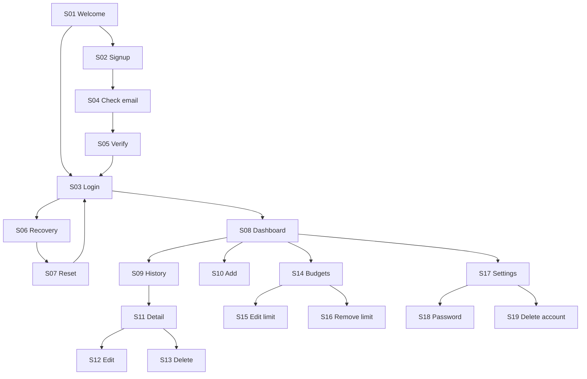

# Personal Finance Tracker - Complete App Flow Specification

Version: 1.0 | Prepared: 3 November 2026 | Status: implementation behavior contract

Companions: [PRD](01-product-requirements.md), [API](02-technical-requirements.md), [UI](04-ui-ux-design-brief.md), [schema](05-backend-schema.md). This document enumerates every V1 page and dialog. Do not add routes, payment flows or placeholder features from the source's bonus section.

## 1. Screen and route inventory

| ID | Screen | Route/presentation | Access |
|---|---|---|---|
| S01 | Welcome | `/` | Public |
| S02 | Create account | `/signup` | Public |
| S03 | Sign in | `/login` | Public |
| S04 | Check verification email | `/check-email` | Public |
| S05 | Verify email result | `/verify-email#token=...` | Public |
| S06 | Request password reset | `/forgot-password` | Public |
| S07 | Set new password | `/reset-password#token=...` | Public |
| S08 | Dashboard | `/app/dashboard` | Verified session |
| S09 | Transaction history | `/app/transactions` | Verified session |
| S10 | Add transaction | `/app/transactions/new` | Verified session |
| S11 | Transaction detail | `/app/transactions/:id` | Owner |
| S12 | Edit transaction | `/app/transactions/:id/edit` | Owner |
| S13 | Delete transaction confirmation | `/app/transactions/:id/delete` | Owner |
| S14 | Monthly budget | `/app/budgets?month=YYYY-MM` | Verified session |
| S15 | Set/edit budget | `/app/budgets/:month/edit` | Verified session |
| S16 | Remove budget confirmation | `/app/budgets/:month/remove` | Owner of existing budget |
| S17 | Settings/profile | `/app/settings` | Verified session |
| S18 | Change password | `/app/settings/password` | Verified session |
| S19 | Delete account confirmation | `/app/settings/delete-account` | Verified session |
| S20 | Help and calculation guide | `/help` | Public |
| S21 | Privacy and data use | `/privacy` | Public |
| S22 | Not found | Unmatched route or missing resource variant | Public/owner-scoped |
| S23 | Session expired | S03 with `reason=expired` and safe `returnTo` | Public state |
| S24 | App/service failure | In-place route error boundary, not a new URL | State on any page |

S13 and S16 render as accessible dialogs over S11/S14 when opened internally on desktop, and as full-page confirmations below 768 px or on direct navigation. Both have canonical URLs and identical behavior. S19 is always a full page. S23 and S24 are states rather than additional data models.

Public-only auth pages redirect an already signed-in verified user to S08, except verification/reset pages: those must explain that the user should sign out before using another account's link. Help/privacy remain accessible signed in. Root S01 redirects an active verified user to S08 after session bootstrap.

## 2. Navigation map

## 3. Universal interaction contract

### 3.1 App shell

Desktop: left navigation Dashboard, Transactions, Budgets; lower links Help and Settings; top-level Add transaction button and account menu. Account menu actions: Settings and Sign out. Mobile: header with app name and account menu, bottom navigation Dashboard/Transactions/Budgets/Settings; Add transaction is a clearly labeled button within the page header, not an unlabeled floating icon. Help is available in Settings and on public pages. App logo navigates S08 when authenticated and S01 otherwise.

Navigation announces page title, moves focus to the main H1 and preserves browser back/forward. Active item uses `aria-current=page`. Links open routes; buttons perform actions. No hidden hover-only transaction actions. Public footer links Help and Privacy. No external support chat or email-send button is present.

### 3.2 Initial loading, retries and authentication

Session bootstrap shows a nonfinancial shell skeleton; no old user's data may flash. Anonymous protected requests redirect S03 with allowlisted relative `/app/...` returnTo. Expired sessions use S23. Unsafe external return targets are discarded. Current passwords/tokens never enter return URLs.

Data loading uses size-stable skeletons labeled "Loading". An initial request failure replaces the affected panel with a concise error and Retry. A refetch failure keeps last confirmed values, labels them "Could not refresh" and offers Retry. Buttons with requests pending show action text such as "Saving..." and prevent duplicate submits. Cancel/back during a financial submit is disabled until response or timeout; after timeout keep input and original operation key.

401: clear private cache and navigate S23. 403 CSRF expiry: reacquire once; preserve input; explicit Retry for mutations. 404 missing/foreign resource: S22 resource variant. 409 stale data: show "This record changed in another tab. Review the latest version." with Load latest and Cancel; retain a read-only copy of unsaved values until user chooses. Never silently overwrite. 422: field-level errors plus error summary focused at top. 429: inline cooldown and retry time. 5xx/network: S24 panel; no success toast.

The global rules apply after endpoint-specific handling: login 401 stays on S03, initial anonymous session bootstrap is expected, and 409 `TRANSACTION_LIMIT_REACHED`/`IDEMPOTENCY_CONFLICT` use their explicit form message rather than the stale-version dialog. Invalid account-token 422 uses S05/S07 recovery state. Only a previously established session that becomes invalid uses S23.

### 3.3 Forms and unsaved changes

Validate on submit, then revalidate edited invalid fields on blur. Fields retain input after errors. Save is disabled while unchanged for edit/profile forms and while a request is pending; add forms allow submission so missing-field errors can be surfaced. Required fields are marked in visible text; errors use text and icon, not color alone.

For dirty transaction/budget/profile forms, Cancel, navigation, browser Back and dialog close open an unsaved-changes prompt: "Discard your changes?" Buttons Keep editing (default focus) and Discard changes. Escape selects Keep editing. Reload/close uses browser beforeunload warning where supported. Password forms use the same in-app guard but never preserve passwords across a route change, logout or session expiry.

Success toasts are polite live announcements, visible six seconds and dismissible with Close. Critical save failures remain inline until resolved. No auto-expiring Undo for destructive operations; deletion is permanent after confirmation.

### 3.4 URL/query behavior

Dashboard/history use explicit applied query keys `dateFrom`, `dateTo`, optional `type`, optional `categoryId`; history also uses `page`. Draft filter changes do not fetch until Apply. Reset applies the current month/all types/all categories immediately and returns page to 1. Invalid known query values show "These filters are invalid" with Reset filters; do not run an expensive fallback query. Unknown query keys are stripped with replace navigation; API rejects unknown keys if sent.

Filter controls: date preset (This month, Last month, Custom), date start/end, type (All/Income/Expense), category (All plus allowed categories), Apply, Reset. Selecting a preset fills draft dates; Custom allows manual dates. Type change clears an incompatible draft category. Range validation: both required, start <=end, no earlier than 2000-01-01, maximum 366 days. Reporting can include future days; entry forms cannot.

Link returnTo is a relative safe internal path including nonsecret filter query. Default fallbacks: add -> S09 current month; detail/edit/delete -> S09; budget editor/remove -> S14 selected month. A cancelled child route returns its explicit originating route if safe, not an unreliable `history.back()`.

### 3.5 Device and offline behavior

At <768 px, filter controls are in a sheet opened by Filters (count badge for nondefault filters). Sheet buttons Apply, Reset and Close follow the same draft rules; Close discards only unapplied filter changes without the financial-form guard. Applied filters appear as readable summary chips; each removable chip applies its removal and resets page.

Offline banner: "You're offline. Reconnect to save changes." Display already loaded data with a stale label; disable submit/delete/logout-all requests and give Retry after reconnection. Do not claim offline persistence. Sign out can clear local UI immediately but warns "Sign-out could not be confirmed on the server" if revocation fails; retry revocation when online before navigating into a different account.

## 4. Public and account screens

### S01 - Welcome

- Content: name, one-sentence value proposition, three feature summaries (record, understand, budget), manual-data explanation. No invented user counts, testimonials or bank logos.
- Create account -> S02. Sign in -> S03. Help -> S20. Privacy -> S21.
- Success: route loads and public controls remain usable without API except session check.
- Empty: not applicable; static content. Session-check outage: show public content with a small service-status banner, allow Sign in. No false authenticated redirect.

### S02 - Create account

- Fields: name, email, password, confirm password. Password visibility toggle has Show password/Hide password labels and never submits. Helper states 12-128 characters. Confirm is client-only and not sent.
- Create account POSTs registration with CSRF. 202 -> S04. Keep email only in navigation memory for the resend form; never URL/localStorage. S04 remains usable if refreshed by re-entering email.
- Existing account uses the identical generic success path. Account creation does not sign the user in. Never replace an existing account's password.
- Sign in -> S03. Help/Privacy -> respective pages, with dirty-form warning only if meaningful input exists.
- Error: field errors for invalid name/email/password; generic service failure with Retry. Empty: blank form, no account-specific assumptions. Success copy: "If this address can be registered, a verification link will arrive shortly."

### S03 - Sign in

- Fields: email, password; visibility toggle. Sign in POSTs login. Success -> safe returnTo or S08. Obtain fresh session summary and clear any cache from prior user.
- Forgot password -> S06. Create account -> S02. 401 -> "Email or password is incorrect." 403 EMAIL_UNVERIFIED -> S04 with email in memory. 429 -> cooldown.
- No Remember me, social login or MFA controls. Password manager autofill and paste must work. Empty: blank form. Service unavailable retains email but does not log/display password elsewhere.

### S04 - Check verification email

- Generic explanation, editable email field (prefilled from memory when available), Resend verification, Back to sign in.
- Resend POSTs generic endpoint; success: "If verification is needed, a new link will arrive shortly." Button disabled for 60-second cooldown. Refresh does not reveal whether a known account exists.
- Does not poll mailbox, open a third-party mail app or navigate automatically on delivery. User follows link to S05; Back to sign in -> S03.
- Error: network/429 field-independent message. Empty email -> required-field error. No financial data is shown.

### S05 - Verify email result

- On entry, capture fragment token, immediately remove fragment, keep in memory. Initial view asks Verify email; do not consume token automatically on page GET or email scanner access.
- Verify email POSTs token. Success panel: "Email verified. You can now sign in." Sign in -> S03.
- Missing/invalid/expired/already-used token has one safe error: "This verification link is invalid or expired." Request a new link -> S04; Back to sign in -> S03. Do not expose token details.
- A network failure preserves token in current memory for Retry; reload requires reopening the link. If already authenticated, show "Sign out to verify another account" with Sign out and Back to dashboard. Do not silently change the signed-in user's identity.

### S06 - Request password reset

- Field: email. Send reset link -> POST forgot-password, then same screen confirmation: "If an account exists, reset instructions will arrive shortly."
- Resend uses same button after cooldown. Back to sign in -> S03.
- Syntax error is local/422; account existence is never disclosed. Dependency failures use generic confirmation server-side plus operational alert, so timing/copy do not reveal accounts. Network request failure itself shows Retry.

### S07 - Set new password

- Capture/remove fragment as S05. Fields: new password, confirm password; visibility toggle. Reset password enabled only with token present, posts token/newPassword.
- Success: clear sensitive fields, show "Password updated. Sign in again." -> S03. Every prior session is invalidated.
- Invalid/missing/expired/used token: fields disabled, Request a new link -> S06. Wrong confirmation: inline mismatch. A network failure preserves current form only in memory; no automatic retry that could confuse a consumed token.
- If a lost success response is followed by an invalid-token response, explain "This link may have been used. Try signing in with your new password or request another link." No claim that a reset failed atomically unless confirmed.

## 5. Financial screens

### S08 - Dashboard

Entry: default current month; restore explicit valid query filters on direct links. Read `GET /dashboard` and categories. Heading "Overview" plus greeting using profile name. Header Add transaction -> S10 with safe returnTo. Filters as universal contract.

Sections in order:

1. Income, Expenses, Net cash flow cards: display selected period and recorded-value meaning; informational, no hidden click behavior.
2. Monthly budget card: explicit month, limit/spent/remaining, status and progress; Set budget -> S15 when unset; Manage budget -> S14 selected month when set. Label "Full-month spending; dashboard filters do not apply." The month is selected range end's month.
3. Spending by category donut and accessible category table; click a segment or category name applies that category to current filters and updates all filtered panels. Legend names are buttons; no pie segment hides data. Chart/data-table toggle switches presentation only.
4. Monthly trends: grouped income/expense bars for all intersecting months. Clicking a month narrows date range to that month's intersection with the prior range; keep category/type. Labels identify partial months. A bar keyboard alternative exists in the monthly data table. Reset restores current month.
5. Recent transactions: up to five filtered records, each opens S11; View all -> S09 with same filters, page 1. No row-level delete on dashboard.

Loading: cards/charts/rows stable skeleton; budget may not show guessed zero. Empty entire ledger: headline "Start with your first transaction", Add transaction CTA, zero recorded totals, illustrative chart placeholder without fake data. Empty filter selection: "No transactions match these filters", Reset filters; budget can still show real full-month spending. Only income matches: totals accurate, explicit no-expense chart state. No budget: Set budget CTA. Error/refetch failure follows global panel rules; a failed categories fetch disables category-specific interactions, preserves other working content.

### S09 - Transaction history

- Header Add transaction -> S10. Applied period and count shown. Filter bar/sheet uses global contract.
- Desktop columns: date, category, note preview, type, amount, Actions. Mobile cards: category/type, signed amount with label, date, truncated note, View/Edit/Delete buttons. Empty note shows em dash in table, omitted on mobile.
- Row or View -> S11; Edit -> S12; Delete -> S13. Interactive actions stop row activation. All carry current history returnTo. Amount uses plus for income and minus for expense; sign is display-only.
- Pagination: Previous/Next, "Page N of M", total count; disable unavailable directions. Never silently load all records. Page changes update URL and move focus to results heading; filters reset page to 1.
- Empty ledger: "No transactions yet" + Add transaction. Filtered empty: "No matches" + Reset filters. Out-of-range page after deletion: replace URL with last valid page (minimum 1) and fetch. Error: Retry results; filters remain usable.
- No bulk select, export or text-search controls. Category filter is sufficient in V1.

### S10 - Add transaction

- Fields/order: Type segmented choice (Expense default), Amount (rupee prefix), Category, Date (today in Asia/Kolkata), Note optional with character count.
- Type change clears selected category if incompatible; show only matching categories. Default category is unselected so the user deliberately chooses it. Amount input uses decimal keyboard, accepts digits plus one decimal point, no rounding. Date cannot exceed today; server recalculates today on submit.
- Save transaction creates one operation key and POSTs. Success: "Transaction added"; navigate returnTo with data invalidated. If entry lies outside destination filters, show persistent note "Saved outside your current filters" with View transaction -> S11. Do not modify filters without notice.
- Cancel/back follows dirty guard. No Save and add another in V1. Empty amount/category/date -> inline errors. Missing categories: "Categories could not load", Retry; save disabled. Transaction cap -> explain limit, link to history; retain draft.
- Timeout: "Save could not be confirmed" with Retry using same key, View history and Keep editing; editing after timeout requires resolving/reconciling the original operation before creating a new submit key. Successful response followed by stale summary is still a successful save.

### S11 - Transaction detail

- Fetch owned resource; show type, formatted amount, category, date, full plain-text note ("No note" when absent), created/updated timestamps in account timezone.
- Edit -> S12. Delete -> S13. Back to transactions -> safe originating history/dashboard route or S09 default.
- Loading: detail skeleton. Missing/foreign record -> S22 resource variant. Error -> inline Retry. Empty note is not an error. No financial account/payment method is inferred.

### S12 - Edit transaction

- Load current resource and categories, prefill S10 controls, retain resource version. Save changes submits full editable DTO/version with new operation key. Amount/date/type/category rules identical to S10.
- Success: "Transaction updated"; return S11 carrying original list returnTo; all aggregates invalidated. If new date excludes it from original list, detail shows that informational condition.
- Cancel -> S11 with dirty guard. 409: preserve unsaved values in read-only comparison, show current server values after Load latest; user explicitly re-enters/reapplies changes and saves against new version. No automatic merge of financial fields.
- If deleted elsewhere -> missing variant with Back to transactions; retain unsaved values in memory for review, never recreate automatically. Network failure retains input/key for retry. Empty/error controls as S10.

### S13 - Delete transaction confirmation

- Show exact type, amount, category and date. Copy: "Delete this transaction? This cannot be undone. Your recorded totals and budget spending will update."
- Default focus Cancel. Cancel/Close/Escape -> S11 or originating list. Confirm button Delete transaction -> DELETE with displayed version and operation key; disable dismiss while pending.
- Success 204: "Transaction deleted", navigate original list/dashboard (never missing detail), invalidate all finance queries. Server failure keeps dialog/details and Retry; no row removed until confirmed. 409 requires reviewing the updated record in S11 before a new delete. 404 -> "This transaction is no longer available" plus Back to transactions; do not expose another owner's data.
- No empty state beyond unavailable resource. Direct-route confirmation fetches resource before enabling Delete.

### S14 - Monthly budget

- Month picker defaults current month; Previous month and Next month move one month. Bound January 2000 through current month +12; disabled controls explain bound. Picker applies immediately and updates URL; no unsaved financial input here.
- Show full-month spent, configured limit, remaining/exceeded amount and status text. Category/type/history filters have no effect. Future month with no entries shows zero spent, valid future limit if configured.
- Unset: "No budget set for [month]", Set budget -> S15. Set: Edit budget -> S15; Remove budget -> S16. View this month's expenses -> S09 with full calendar month and type=expense, no category.
- At 80% show Near limit; 100% Limit reached; above 100% Over limit. No alarming notification outside this screen/dashboard. Entries remain allowed at every status.
- Loading: skeleton. Error: Retry. Empty spending: "No recorded expenses this month"; show real configured limit, not generic empty chart.

### S15 - Set/edit monthly limit

- Month from route shown read-only; field Monthly spending limit with INR prefix and PRD bounds. Helper: "This applies to all expenses in [month]. It will not repeat automatically."
- For existing limit prefill amount and version; otherwise blank, version 0. Save budget PUTs amount/version with key. Success -> S14 same month, toast "Budget saved".
- Cancel -> S14 with dirty guard. Invalid month route -> S22; bad amount -> inline error; conflict -> Load latest comparison/Cancel as S12. No budget copying, category selection or rollover controls. A month change requires leaving editor first.

### S16 - Remove budget confirmation

- Show month and configured limit. Copy: "Remove this spending limit? Your transactions will stay in your history."
- Cancel default focus/Close/Escape -> S14. Remove budget DELETEs month/version/key; success -> S14 unset state and "Budget removed".
- 409 -> return to S14 to review current budget; 404 -> "This budget has already been removed" and Back to budget; network error retains confirmation and key. Does not delete transactions.

## 6. Settings, help and system screens

### S17 - Settings/profile

- Profile: editable name; read-only email, INR and Asia/Kolkata. Save profile PATCHes name/version; disabled unchanged; success updates shell greeting and shows Profile updated. Error retains name; conflict Load latest behavior.
- Security: Change password -> S18; Sign out of all devices -> confirmation dialog with Cancel (default) and Sign out everywhere; POST logout-all then S03 with reason=signed-out. Failure leaves current session usable with Retry.
- Data: Delete account -> S19. Links Help -> S20, Privacy -> S21. No theme/currency/timezone toggle or avatar upload.
- Loading skeleton; empty name is validation error, not a profile empty state. Page errors Retry.

### S18 - Change password

- Fields current password, new password, confirm new password; independent show/hide toggles. Require new password distinct from current. Change password POSTs current/new; success clears all sensitive state and routes S03 with "Password changed. Sign in again."
- Cancel -> S17 with dirty guard. Incorrect current password -> inline error without revoking sessions. 422 length/mismatch -> inline. Network/timeout warns outcome may need checking: Try sign in or Retry; never claim the old password remains active after ambiguous failure.

### S19 - Delete account

- Show email and explicit scope: profile, all transactions, categories, budgets, sessions and account tokens removed from active storage. Explain backup retention/recovery suppression and irreversibility. Link Privacy opens S21 with dirty guard if needed.
- Fields current password, type DELETE. Delete account enabled after text equals exact `DELETE` and password is nonempty; POST-style DELETE body sent to `/me`. Cancel default visual emphasis -> S17.
- Success 204: clear caches/session memory/cookies via server; replace navigation to S01 with "Account deleted" banner. No restoration/undo promise.
- Wrong password -> inline error. Network ambiguous outcome -> explain deletion could not be confirmed, offer Check account (GET session): 401 routes login with neutral message, 200 returns settings and allows a fresh deliberate attempt. Do not assume every 401 proves deletion. Real server failure rolls back whole purge and shows Retry.

### S20 - Help and calculations

- Static sections: adding/editing/deleting, filters and partial months, income/expense/net cash flow formulas, monthly full-scope budget rules, manual-data limitation, recovery and deletion. Examples are labeled examples, never inserted into a user's ledger.
- Back to app -> S08 when signed in; Back to home -> S01 otherwise. Sign in/Create account links for anonymous visitors. Privacy -> S21. Internal table-of-contents links focus section headings.
- No mail form, live chat, external-resource dependence or contact address invented. Static content has no account-data empty state; asset failure shows S24.

### S21 - Privacy and data use

- Explain stored profile/financial entries, ownership, hosting/email service categories, transactional email, optional pseudonymous product events, operational logging, active-data deletion, backup retention and restore suppression. No unsupported certification or regulatory-compliance claims.
- Back follows explicit safe source route or S01; Help -> S20; signed-in Delete account link -> S19. No acceptance checkbox required merely to read.
- Publishing gate: operator must replace generic service-category wording with actual configured providers/contact and verified retention. Do not ship a fictitious privacy contact. This is launch configuration work, not an unresolved financial-domain rule.

### S22 - Not found/resource unavailable

- Unknown public URL: "Page not found", Home -> S01, Sign in -> S03. Signed-in unknown app URL: Go to dashboard -> S08.
- Missing/foreign transaction: "Transaction not found", Back to transactions -> S09. Invalid/missing budget context: Back to budgets -> S14 current month.
- Never state that a record belongs to another user. Do not render known amounts/names from untrusted route state before owner fetch succeeds.

### S23 - Session expired variant

- S03 layout with banner "Your session ended. Sign in to continue." Safe returnTo retained. Financial drafts may remain only in active-tab memory; after sign-in by the same user, offer Resume unsaved entry or Discard. Different user login clears draft immediately.
- Resume fetches current record/version and requires explicit review before Save; never silently submits. Logout and full refresh discard drafts. Password drafts are never retained.

### S24 - App/service failure state

- Component fetch error: scoped panel "We couldn't load this section", Retry. Full render boundary: "Something went wrong", Reload page and Go home/dashboard as appropriate. Show request reference only, no stack/payload.
- Saving ambiguity uses form-specific messages above, not a generic blank page. Working navigation/help should remain usable if possible.
- Repeated failure keeps state stable; do not auto-loop refresh. A production maintenance outage may show the same state; there is no invented status-page URL.

## 7. Reference end-to-end paths

1. New account: S01 -> S02 -> S04 -> email link S05 -> Verify -> S03 -> S08 empty -> S10 save -> S08 populated.
2. Month review: S08 Apply November -> click Food category -> S09 same filters -> S11 -> S12 move to October -> S11 -> original list shows refreshed November without the moved record.
3. Budget: S14 choose November -> S15 set INR 10,000 -> S14 -> S09 November expenses -> S10 add INR 10,500 expense -> S14 Over limit, entries remain enabled.
4. Concurrency: two tabs open S12 version 1 -> tab A saves version 2 -> tab B gets 409 -> Load latest -> explicit review -> save version 2 input produces version 3.
5. Recovery: S03 -> S06 -> email link S07 -> reset -> S03 -> login -> S08. Previously active tab receives 401 on next request and becomes S23.
6. Account exit: S17 -> S19 -> confirmation -> S01. Browser back cannot display cached private data or restore a valid session.

## 8. Flow acceptance checklist

Verify each S01-S24 success and stated error/empty variant. Test desktop and 390 px mobile, keyboard-only operation, back/forward, direct child URLs, stale links, offline state, 401 mid-form, a lost write response, duplicate submit and another-user ID. All visible controls must either perform the specified action or explain why they are disabled. No dead buttons, guessed data or source-bonus controls are acceptable.
