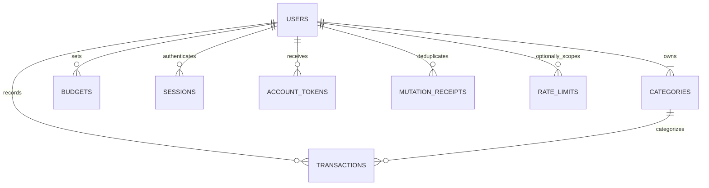

# Personal Finance Tracker - Complete Backend Schema

Version: 1.0 | Prepared: 3 November 2026 | Status: logical and physical storage contract

Companions: [PRD rules](01-product-requirements.md), [API/auth requirements](02-technical-requirements.md), [flows](03-app-flows.md). MongoDB is selected in the source, so "tables/columns/foreign keys" are represented as collections/fields/service-enforced references. Do not generate an unrelated SQL schema. This document specifies all V1 persistent application entities.

## 1. Conventions and validation

- Application database: `pft_app`; deletion-control database: `pft_control` on the same deployment/client for atomic cross-database deletion transactions. Use separate suffixed databases per environment. Backups/restores of the app exclude the live control database, as described below.
- ObjectId `_id` is primary key for all collections except rate-limit counters, whose key is a string. MongoDB creates unique `_id` indexes automatically. Public IDs serialize to 24-character hex strings.
- `Date` means BSON UTC datetime, never a formatted local date. Date-only business fields are validated canonical strings. All fields are required unless marked nullable or optional; explicit null is permitted only where specified. No arbitrary metadata blobs.
- `Long` means BSON signed 64-bit integer; use a Mongoose BigInt/BSON Long adapter. `Int` means integer-valued BSON numeric field with safe bounds. Strict MongoDB validators and Mongoose/service validation must agree. Default values below are supplied by the service, not trusted from the client.
- `version` starts at 1 and increments for each editable resource update. `users.version` tracks profile edits only; financial writes use `ledgerRevision`; auth changes use `authVersion`. Do not invalidate profile forms merely because a transaction was added.
- Unknown fields are rejected. Set Mongoose strict validation, explicitly allowlist update fields and disable user-supplied query operators. Never pass body directly to `$set`.
- All references below are logical foreign keys; the application must check ownership/type, use transactions when necessary and prohibit orphan creation. No production direct DB editing bypassing the service.

## 2. Relationship map

Deletion tombstones intentionally outlive the deleted owner and have no live-user FK. Rate counters may be anonymous. There are no shared ledgers, membership, bank account, role, payment, attachment, recurring-job, export-job or custom-category collections in V1.

## 3. `users`

| Field | Type | Default/constraint | Meaning |
|---|---|---|---|
| `_id` | ObjectId | Generated | PK and immutable owner identity |
| `name` | String | Trim, 1-80 Unicode chars | Display name |
| `emailNormalized` | String | Trim/lowercase, valid email, <=254 | Unique login identity |
| `passwordHash` | String | Encoded Argon2id result | Never selected into DTOs |
| `emailVerifiedAt` | Date or null | null | Verification status; null blocks financial access |
| `currency` | String enum | `INR`, immutable | Single-ledger currency |
| `timeZone` | String enum | `Asia/Kolkata`, immutable | Date defaults and reporting context |
| `authVersion` | Int | 1, >=1 | Increment on reset/change/logout-all |
| `version` | Int | 1, >=1 | Optimistic profile edit version |
| `ledgerRevision` | Long | 0, >=0 | Common financial/deletion concurrency lock |
| `transactionCount` | Int | 0, 0-10,000 | Transaction cap guard, maintained atomically |
| `analyticsId` | String | Random UUIDv4, immutable | Pseudonymous product event ID |
| `createdAt` | Date | Server now | Creation instant |
| `updatedAt` | Date | Server now/update | Any user document update |

Indexes: unique `{emailNormalized:1}` (`uq_user_email`); unique `{analyticsId:1}`. No client may set hash, verification, authVersion, ledgerRevision, transactionCount or analyticsId. `PATCH /me` allows name + version only. Email/currency/timezone editing is out of V1.

Unverified accounts are purged after seven days by a maintenance script, including seeded categories/tokens, under the same deletion transaction rules. The script runs daily via a deployment-scheduled command; no application job collection needed. It must not delete recently verified users because it rechecks verification inside the transaction. Purge records get tombstones just like user-triggered deletion.

## 4. `categories`

| Field | Type | Default/constraint |
|---|---|---|
| `_id` | ObjectId | Generated PK |
| `userId` | ObjectId | FK users._id, immutable |
| `key` | String enum | Stable seed key listed below |
| `name` | String | Exact seed display label, <=40 chars |
| `type` | String enum | `income` or `expense`, immutable |
| `colorKey` | String | Semantic token from UI seed mapping |
| `sortOrder` | Int | 1-14 |
| `createdAt` | Date | Server now |

Indexes: unique `{userId:1,key:1}`; `{userId:1,type:1,sortOrder:1}`. Only internal registration/repair scripts may create seeds; clients can read own categories but never create/edit/delete them. Seeds and all IDs are per-user, not shared global references.

| Key | Name | Type | Sort | colorKey |
|---|---|---|---|---|
| salary | Salary | income | 1 | income-1 |
| freelance | Freelance | income | 2 | income-2 |
| gifts | Gifts | income | 3 | income-3 |
| other_income | Other income | income | 4 | income-4 |
| food_dining | Food & dining | expense | 5 | expense-1 |
| groceries | Groceries | expense | 6 | expense-2 |
| transport | Transport | expense | 7 | expense-3 |
| housing | Housing | expense | 8 | expense-4 |
| utilities | Utilities | expense | 9 | expense-5 |
| health | Health | expense | 10 | expense-6 |
| education | Education | expense | 11 | expense-7 |
| shopping | Shopping | expense | 12 | expense-8 |
| entertainment | Entertainment | expense | 13 | expense-9 |
| other_expense | Other expense | expense | 14 | expense-10 |

Income colors use the same first four chart palette positions if needed; only expenses appear in the category donut. Seed changes require a migration preserving existing category IDs/keys; never delete categories referenced by transactions.

## 5. `transactions`

| Field | Type | Default/constraint |
|---|---|---|
| `_id` | ObjectId | Generated PK |
| `userId` | ObjectId | FK users._id, immutable |
| `type` | String enum | `income` or `expense` |
| `categoryId` | ObjectId | FK categories._id, same owner and type |
| `amountMinor` | Long | 1-100,000,000 inclusive |
| `currency` | String enum | `INR`, equals user currency, immutable |
| `occurredOn` | String | Valid `YYYY-MM-DD`, 2000-01-01 through today in account timezone |
| `note` | String | Empty default, <=280 Unicode chars, plain text |
| `version` | Int | 1 initially, increment on edit |
| `createdAt` | Date | Immutable server now |
| `updatedAt` | Date | Server now/update |

Indexes:

| Index | Keys | Purpose |
|---|---|---|
| `ix_tx_owner_date` | userId 1, occurredOn -1, createdAt -1, _id -1 | Main list sort and bounded date range |
| `ix_tx_owner_type_date` | userId 1, type 1, occurredOn -1, createdAt -1, _id -1 | Type filter and expense budget aggregation |
| `ix_tx_owner_category_date` | userId 1, categoryId 1, occurredOn -1, createdAt -1, _id -1 | Category/date filter |

Do not index note or every field. Use explain plans with the release fixture before adding indexes for combined category+type filters; category implies one type. No uniqueness by amount/date/note: two legitimate identical purchases must be allowed. Retry deduplication uses mutation receipts, not financial similarity.

Transactions are hard-deleted after explicit confirmation. No `deletedAt`/trash/undo fields in V1. Services enforce `transactionCount` atomically: increment on create only if <10,000; decrement on delete; unchanged on edit. Reconciliation script checks count versus owned rows and reports mismatch without silently rewriting amounts.

## 6. `budgets`

| Field | Type | Default/constraint |
|---|---|---|
| `_id` | ObjectId | Generated PK |
| `userId` | ObjectId | FK users._id, immutable |
| `month` | String | Valid `YYYY-MM`, >=2000-01, <=current month +12 at creation/edit |
| `limitMinor` | Long | 1-100,000,000 |
| `currency` | String enum | `INR`, immutable |
| `version` | Int | 1 initially, increments per edit |
| `createdAt` | Date | Server now |
| `updatedAt` | Date | Server now/update |

Unique index `{userId:1,month:1}` (`uq_budget_owner_month`). One overall expense budget, not per category. Do not store spent/remaining/percentage/status: calculate from all that owner's expense records between month start/end inclusive. This avoids stale values when a historical transaction changes month or type.

PUT version 0 creates only if absent. A nonzero version updates only the matching existing record. Removing budget leaves transactions intact. A row absent is an unset budget, not a zero-value limit.

## 7. `sessions`

| Field | Type | Default/constraint |
|---|---|---|
| `_id` | ObjectId | Generated; appears as JWT sid |
| `userId` | ObjectId | FK users._id |
| `authVersion` | Int | User authVersion at login |
| `createdAt` | Date | Server now |
| `lastSeenAt` | Date | Server now, activity update <=once/5 minutes |
| `expiresAt` | Date | createdAt +7 days, absolute |
| `revokedAt` | Date or null | null until revoked |

Indexes: `{userId:1,revokedAt:1}`; TTL `{expiresAt:1}` with expireAfterSeconds 0. TTL is cleanup only: every request explicitly checks absolute expiry, 24-hour idle expiry and revokedAt. Delayed TTL deletion never grants extra validity.

No raw JWT/refresh token, device fingerprint or full user-agent/IP stored. JWT is signed and cookie-only; session existence enables immediate revocation. A valid signature without an active row/user is insufficient. Password/reset/logout-all increments user.authVersion and marks sessions revoked in the same transaction; old cookies fail their next request.

## 8. `account_tokens`

| Field | Type | Default/constraint |
|---|---|---|
| `_id` | ObjectId | Generated |
| `userId` | ObjectId | FK users._id |
| `kind` | String enum | `verify_email` or `reset_password` |
| `tokenHash` | String | SHA-256 hex of 32 random bytes; raw token never stored |
| `createdAt` | Date | Server now |
| `expiresAt` | Date | +24 h verification or +30 min reset |
| `consumedAt` | Date or null | null initially; atomic consume |

Indexes: unique `{tokenHash:1}`; `{userId:1,kind:1,consumedAt:1}`; TTL `{expiresAt:1}` expireAfterSeconds 0. Service issues new token inside a transaction that first marks prior unconsumed same-kind tokens consumed. Acquire a user-row write lock in that transaction so simultaneous resend requests cannot leave two live tokens. Query token by hash, expected kind, consumedAt=null and expiresAt>now; consume and apply effect in one transaction.

Acquire that common user lock by incrementing ledgerRevision, despite its primary use for financial mutations; this field is an internal serialization counter, not a visible transaction count. Do not bump profile version or authVersion merely to resend email. Every token consume/reissue rechecks the live user inside the transaction, preventing a concurrent purge from leaving an orphan token.

Verification sets emailVerifiedAt only if null. Reset changes password hash, increments authVersion and revokes all sessions. Tokens are never returned in normal API JSON or logs. The mail adapter receives a short-lived raw token only in memory after commit. A failed delivery is handled by a new resend/recovery attempt under rate limits; no unencrypted retry queue exists.

## 9. `mutation_receipts`

| Field | Type | Default/constraint |
|---|---|---|
| `_id` | ObjectId | Generated |
| `userId` | ObjectId | FK users._id |
| `key` | String | Valid client UUID per deliberate financial submit |
| `fingerprint` | String | SHA-256 of canonical method/path/validated body |
| `httpStatus` | Int | 200, 201 or 204 |
| `response` | Object or null | Exact allowlisted successful data DTO; null for 204 |
| `createdAt` | Date | Commit timestamp |
| `expiresAt` | Date | createdAt +24 h |

Indexes: unique `{userId:1,key:1}`; TTL `{expiresAt:1}` expireAfterSeconds 0. Bound serialized response to 4 KiB. Store successful financial mutations only, not password/account deletion requests. Financial DTOs may contain note/amount, so receipt data has identical ownership and purge rules to transaction records. Do not log it.

Receipt and domain write commit together. On duplicate-key racing transaction, abort/retry by reading the already committed receipt; do not repeat the domain effect. Check expiresAt in service, not only TTL. Reuse after expiry is treated as a new operation only after removing expired receipt safely under the same transaction/user lock; client must reconcile ambiguous old operations rather than automatically retry after 24 hours.

## 10. `rate_limits`

| Field | Type | Default/constraint |
|---|---|---|
| `_id` | String | HMAC-derived scope/key + UTC window start |
| `scope` | String enum | login, signup, resend, recovery, api, write |
| `userId` | ObjectId or null | Authenticated owner for session-scoped limits; null for public |
| `count` | Int | >=1, atomically increment |
| `windowStart` | Date | Fixed-window start |
| `expiresAt` | Date | End of window, max one hour |

Indexes: TTL `{expiresAt:1}` expireAfterSeconds 0; `{userId:1}` for deletion. `_id` encodes a keyed HMAC of IP/email/session, not raw identity. Separate IP and identity limits each must pass. Increment/check atomically with upsert and duplicate-key race handling; do not implement read-then-write counters. Fixed-window edge bursts are accepted in this bounded pilot; revisit before wider public exposure.

The server checks window boundaries directly even when TTL cleanup lags. Wrong email syntax is validated before email-key hashing. Rotate the rate-limit HMAC secret as an operational change; counters can reset, no financial data affected. Anonymous pseudonymous counters expire within one hour and cannot be linked back through a stored raw email.

## 11. `pft_control.deletion_tombstones`

| Field | Type | Default/constraint |
|---|---|---|
| `_id` | ObjectId | Generated PK |
| `deletedUserId` | ObjectId | Old owner ID; deliberately no live FK |
| `deletedAt` | Date | Server now |
| `expiresAt` | Date | deletedAt +30 days |
| `reason` | String enum | user_request or unverified_expiry |

Indexes: unique `{deletedUserId:1}`; TTL `{expiresAt:1}` expireAfterSeconds 0. Do not store email, name, note, amount or password. Tombstones are service-only recovery control data, not accessible via application APIs. Re-registering the same email receives a new user ID and no access to the old ledger.

The live control database is retained separately from app restore targets. App logical backups exclude it; if using cluster snapshots, restore into an isolated deployment and apply the **current live** control database before promoting the restored app. Never overwrite current tombstones with an old backup. Cross-database transaction support must be verified on the selected MongoDB deployment and both DBs must use the same MongoClient/session. This is a launch gate, not an assumption that every backup plan supports exclusions.

## 12. Atomic operations and invariants

### Registration

Normalize/validate -> Argon2 hash outside transaction -> insert user +14 categories +token inside transaction -> commit -> send verification email outside transaction -> generic 202. Unique email races return generic success; never overwrite existing user. Token creation/resend locks user row. A DB failure returns service failure, not an invented account.

### Create/update/delete transaction

Authenticate/CSRF -> validate request -> begin transaction -> lock/re-read user and increment ledgerRevision -> check receipt -> validate same-owner category/type -> apply resource predicate/version + transactionCount changes -> save receipt -> commit -> return DTO. For a receipt replay, return without incrementing financial counters or resource versions; a harmless ledger lock update may be avoided by checking receipt before modifying the owner after serialization.

Validate cap under the common owner write lock. An edit changing type/date/category updates the same record and does not create accounting transfers. A delete decrements transactionCount once. Database failures abort counters, resource and receipt together. Write-triggered product events occur only after commit and must be deduplicated by receipt key.

### Budgets

Lock owner as above, receipt check, validate month/limit/version, insert or conditional edit/delete, save receipt, commit. Unique owner/month prevents two concurrent limits. Evaluate returned budget under the transaction snapshot after the mutation. Dashboard refetch may legitimately have a later asOf.

### Account deletion

Verify current password outside transaction, then inside transaction recheck unchanged password hash/authVersion and live user, update owner lock, create control tombstone, delete owned receipts/transactions/budgets/categories/sessions/account_tokens/authenticated rate counters and user. All commit or all roll back. Clear cookie only after successful commit. User cap bounds deletion size; run integration tests on the 10,000-row fixture and measure transaction duration. Chunked deletion that leaves partial active data is not the V1 contract.

Parallel writes must also lock the owner, so a committed purge cannot be followed by an orphan insert. If deletion wins, the write retries and returns 401 because user no longer exists. If write wins first, purge includes it. No route can recreate deleted users implicitly.

### Restore

Restore backup into isolated staging -> apply every live tombstone to purge old owner data -> revoke every restored session and account token -> verify references/counts -> run smoke tests -> promote. A restored password must not resurrect an old session. Backup expiry <=7 days and tombstone retention 30 days provide overlap; if backup retention grows, extend control retention first.

If the current authoritative deletion-control records are unavailable, do not promote the restored app or accept public traffic until those records are recovered. An old control snapshot is insufficient evidence that deleted accounts can safely be restored. Document this fail-closed condition in the recovery runbook and include it in the restore drill.

## 13. Permission and ownership matrix

| Resource/action | Anonymous | Unverified login attempt | Verified owner | Other user | Operator/service |
|---|---|---|---|---|---|
| Register/login/recover | Rate-limited public | Public auth only | Public endpoints available | No identity override | Operate delivery |
| Verify/reset token | Valid single-use token only | Same rule | Must sign out in UI first | Token is proof, not a resource ID | Hashed-token operations only |
| Read/update profile | Denied | Denied | Read; name edit only | Denied | No app browsing role |
| Read categories | Denied | Denied | Own only | 404/empty owner scope | Seed/repair only |
| Transaction CRUD | Denied | Denied | Own only | 404 | Maintenance scripts only, audited outside payload |
| Budget CRUD/summary | Denied | Denied | Own only | 404 | Maintenance scripts only |
| Read sessions/tokens/receipts | Denied | Denied | No raw collection API | Denied | Service only |
| Delete account | Denied | Denied | Current password + confirmation | Denied | Retention purge only |
| Tombstones/rate-limit internals | Denied | Denied | Denied | Denied | Least-privilege service/recovery tools |

JWT sub is the sole ownership source; reject `userId` in body/query. Repository methods require an owner ID argument and cannot have an unscoped default. Aggregation begins with userId match. Category joins include both `_id` and owner checks. Do not populate private user fields into transaction DTOs.

There is one end-user permission class. Infrastructure operators can technically access storage under separately managed provider credentials; minimize this with least privilege, MFA, access logging and no normal product admin UI. Do not promise that encryption at rest makes provider/operator access impossible.

## 14. Data lifecycle, indexes and maintenance

Active account data persists until user deletion; unverified accounts expire after seven days. Token/session/receipt/rate counter retention is as specified. Operational logs: 14 days. Product event store: at most 90 days, remove by analyticsId on account deletion where the configured store supports deletion; if not supported, leave product analytics disabled. Daily backups: seven days; tombstones: 30 days. Privacy copy must match the deployed retention settings.

Use versioned scripts for collection validators, indexes and seed migrations. Create indexes before traffic; disable uncontrolled production autoIndex building. Maintain a migration ledger in deployment tooling/repository release records rather than adding an unspecified application collection. Record script version, checksum, environment, execution time and result without secrets. Deploy additive schema changes first; never drop an index/field used by the currently deployed API during rollback window.

Daily maintenance command: purge expired unverified accounts, inspect TTL backlog, reconcile owner transactionCount, check for orphan references, and report violations. It must not "repair" financial data without explicit operator review. No scheduled monthly report, recurring transaction writer or spending notification job exists.

## 15. Required schema tests

1. Unique normalized email, category seed key and owner/month budget reject duplicates under concurrency.
2. Amount bounds/Long serialization and exact totals pass, including 0.01 and max values.
3. Leap dates and date-only sorting validate; dates like 2026-02-30 are rejected, not regex-accepted.
4. Every CRUD/detail/aggregation route rejects another user's ID/category and body owner injection.
5. Stale versions never mutate data; same receipt key/body replays once; changed body conflicts.
6. TTL-late expired token/session/receipt cannot bypass service expiry checks.
7. Two resends leave one valid token; reset is single-use and revokes sessions immediately.
8. TransactionCount stays exact under duplicate create/delete and concurrent writes at 9,999/10,000.
9. Deletion racing a financial write leaves no orphan; injected midway failure rolls back purge/tombstone.
10. Restore with current tombstones does not resurrect deleted data; all restored sessions/tokens are unusable.
